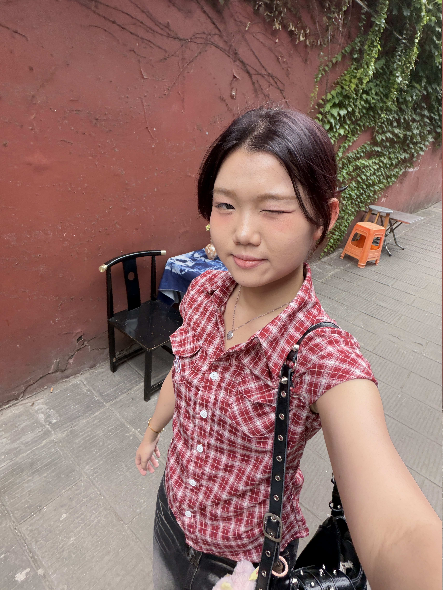
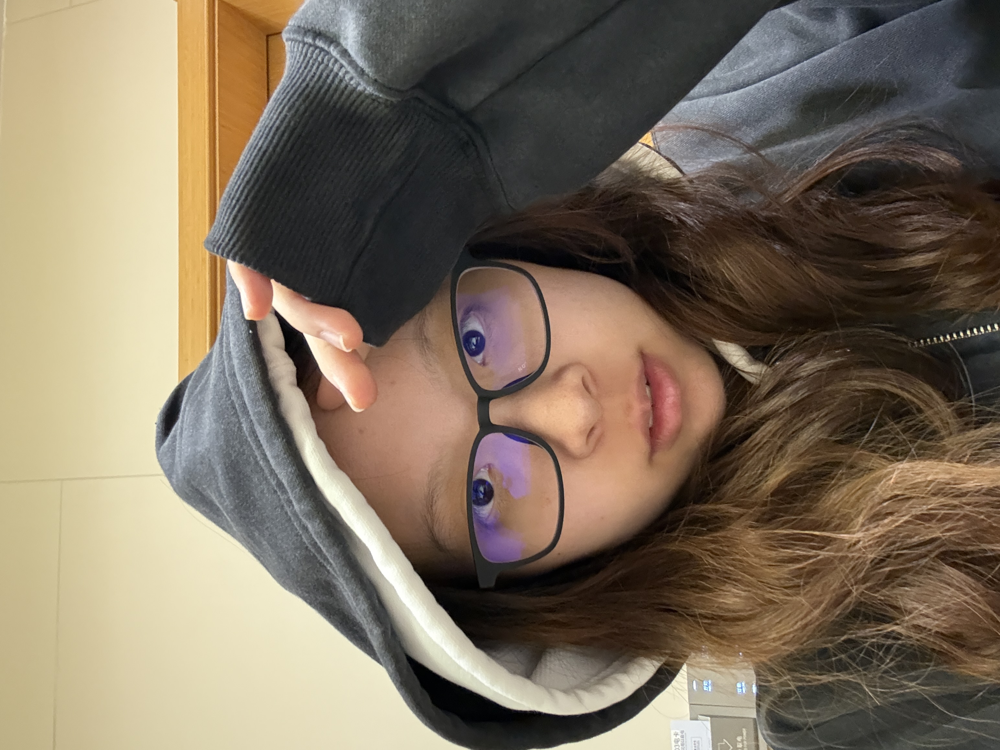
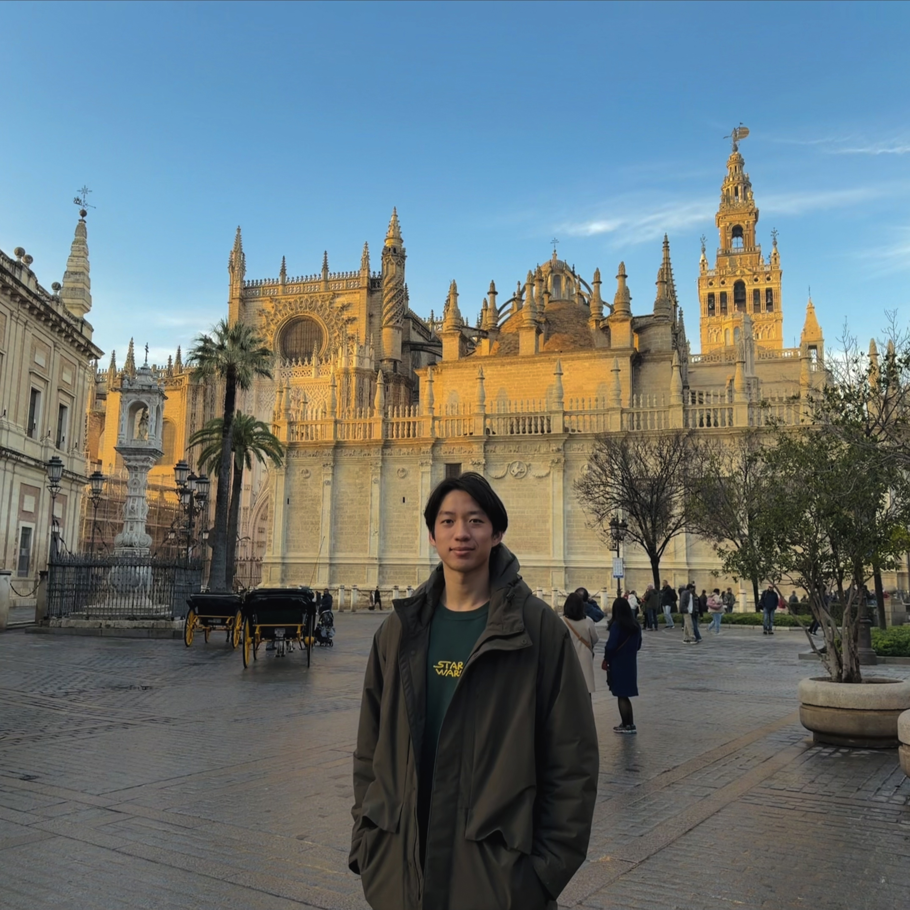
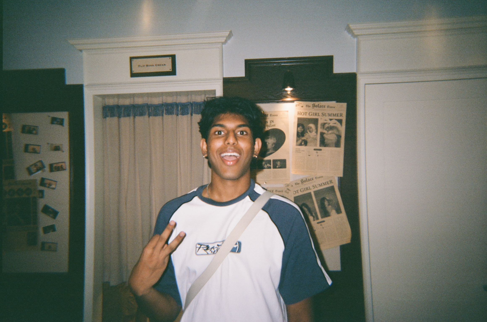
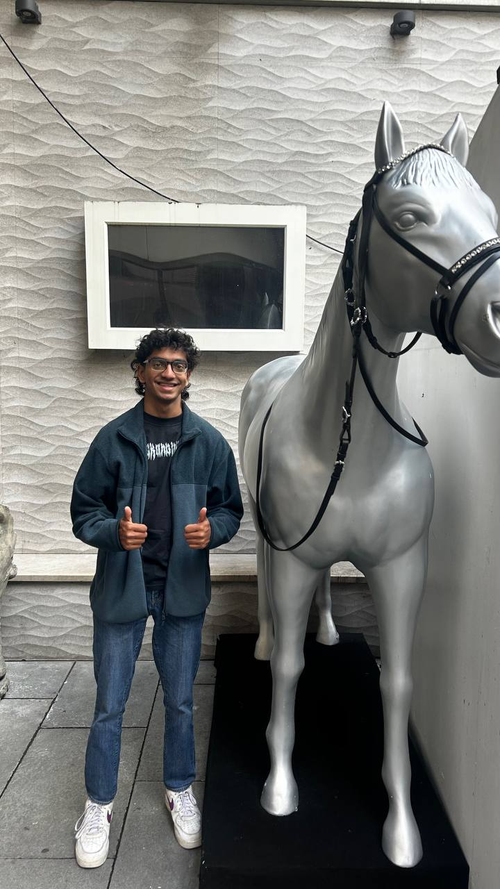

# About Us

We are a team based in the [School of Computing, National University of Singapore](http://www.comp.nus.edu.sg).

You can reach us at the email `seer[at]comp.nus.edu.sg`

## Project team

### Wen Yi Liang

[[github](https://github.com/wenyiliangg)]
[[portfolio](team/wenyiliangg.md)]

* Role: Developer
* Responsibilities: Full-stack developer

### Yanzhu Chen

[[github](http://github.com/yanzhu9)]
[[portfolio](team/yanzhu.md)]

* Role: Developer
* Responsibilities: Full-stack developer

### Aaron Leong

[[github](http://github.com/aaronl248)]
[[portfolio](team/aaron.md)]

* Role: Developer
* Responsibilities: Full-stack developer

### Laxshan

[[github](http://github.com/Slytherax)]
[[portfolio](team/slytherax.md)]

* Role: Developer
* Responsibilities: Full-stack developer

### Aarav Jayapalan 

[[github](http://github.com/purpleshark74)]
[[portfolio](team/purpleshark74.md)]

* Role: Developer
* Responsibilities: Full-stack developer
