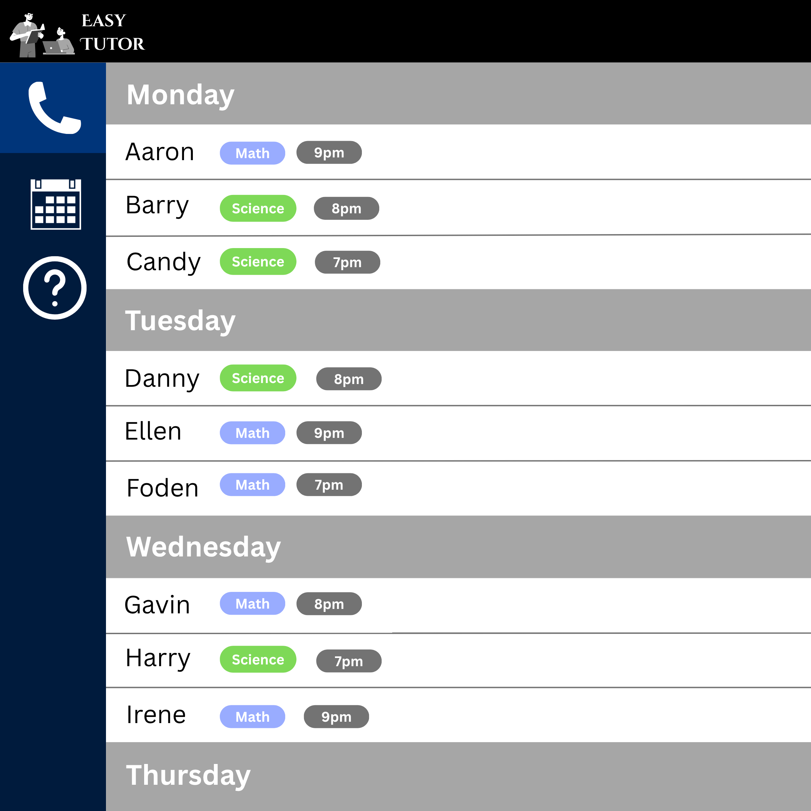
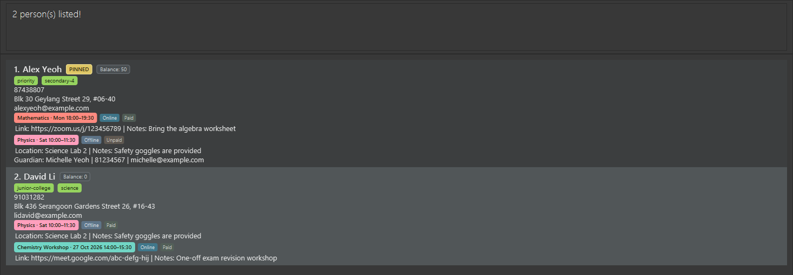

# TutEasy User Guide

TutEasy is a **desktop application for managing contacts, optimized for use through a Command Line Interface (CLI)** while retaining the benefits of a Graphical User Interface (GUI). If you type quickly, TutEasy can help you manage contacts faster than traditional GUI applications.

<!-- * Table of Contents -->
<page-nav-print />

--------------------------------------------------------------------------------------------------------------------

## Quick start

1. Ensure that Java `25` or later is installed on your computer. 
   **Mac users:** Ensure you have the precise JDK version prescribed [here](https://se-education.org/guides/tutorials/javaInstallationMac.html).

1. Download the latest `.jar` file from [here](https://github.com/se-edu/addressbook-level3/releases).

1. Copy the file to the folder you want to use as the _home folder_ for TutEasy.

1. Open a terminal, `cd` to the folder containing the JAR file, and run `java -jar tuteasy.jar`. 
   A GUI similar to the one below should appear in a few seconds. Note how the app contains some sample data. 
   

1. Type a command in the command box and press Enter to execute it. For example, type **`help`** and press Enter to open the help window. 
   Some example commands you can try:

   * `list` : Lists all contacts.

   * `add n/John Doe p/98765432 e/johnd@example.com a/John street, block 123, #01-01` : Adds a contact named `John Doe` to TutEasy.

   * `delete 3` : Deletes the 3rd contact shown in the current list.

   * `clear` : Deletes all contacts.

   * `exit` : Exits the app.

1. Refer to the [Features](#features) section below for details of each command.

--------------------------------------------------------------------------------------------------------------------

## Features

Subject searches are described in the [subject search guide](SubjectSearch.md).

<box type="info" seamless>

**Notes about the command format:** 

* Words in `UPPER_CASE` are the parameters to be supplied by the user. 
  For example, in `add n/NAME`, replace `NAME` with a value such as `John Doe`.

* Items in square brackets are optional. 
  For example, `n/NAME [t/TAG]` can be used as `n/John Doe t/friend` or as `n/John Doe`.

* Items followed by `...` can appear zero or more times. 
  For example, `[t/TAG]... ` may be omitted, or written as `t/friend` or `t/friend t/family`.

* Parameters can be in any order. 
  For example, if the command specifies `n/NAME p/PHONE_NUMBER`, `p/PHONE_NUMBER n/NAME` is also acceptable.

* Extraneous parameters for commands that take no parameters, such as `help`, `list`, `exit`, and `clear`, are ignored. 
  For example, `help 123` is interpreted as `help`.

* If you are using a PDF version of this document, be careful when copying and pasting commands that span multiple lines as space characters surrounding line-breaks may be omitted when copied over to the application.
</box>

### Viewing help: `help`

Shows a message explaining how to access the help page.

Format: `help`

### Adding a person: `add`

Adds a person to the address book.

Format: `add n/NAME p/PHONE_NUMBER e/EMAIL a/ADDRESS [t/TAG]... [sub/SUBJECT cost/COST c/SCHEDULE]`

<box type="tip" seamless>

**Tip:** A student can have up to 10 tags. Tags must be unique, contain no more than 30 characters,
and use only lowercase letters, numbers, and single hyphens between characters.
</box>

* `sub/SUBJECT`, `cost/COST`, and `c/SCHEDULE` must be supplied together when adding a class.
* Times use the 24-hour range `0000`–`2359`, and the end time must be later than the start time.
* A weekly schedule uses `DAYHHmm-HHmm`, for example `Monday1800-1930`.
* A one-off schedule uses `yyyy-MM-ddTHHmm-HHmm`, for example `2026-10-20T1800-1930`.

Examples:
* `add n/John Doe p/98765432 e/johnd@example.com a/John street, block 123, #01-01`
* `add n/Betsy Crowe t/friend e/betsycrowe@example.com a/Newgate Prison p/1234567 t/criminal`
* `add n/John Davis p/91234567 e/johndavis@gmail.com a/Clementi t/exam-prep sub/Math cost/30 c/Monday1800-1930`
* `add n/Jane Tan p/92345678 e/jane@example.com a/Bishan sub/Math cost/30 c/2026-10-20T1800-1930`

### Enrolling a student in a class: `class enrol`

Enrols an existing student in a weekly or one-off class. The student is identified by the index shown in the current
student list. Weekly classes recur on their specified weekday; one-off classes occur only on their specified date.

Format: `class enrol STUDENT_INDEX sub/SUBJECT cost/COST c/SCHEDULE`

Examples:

* `class enrol 1 sub/Physics cost/35 c/Wednesday1700-1830`
* `class enrol 1 sub/Physics cost/35 c/2026-10-20T1700-1830`

The same class can be assigned to multiple students, but its cost must be consistent. A student cannot be enrolled in
the same class more than once.

Enrolled classes appear as coloured badges below each student's email. Each badge includes the subject and lesson
timing, and students enrolled in the same class receive a badge with the same colour. When a student has multiple
classes, each badge group appears on its own row.

A subdued balance badge beside each student's name shows the total cost of that student's unpaid lesson enrolments.
Paid enrolments are excluded. The badge remains visible as `Balance: 0` when the student has no unpaid enrolments.

### Unenrolling a student from a class: `class unenrol`

Removes one class from one student without affecting other students enrolled in that class.

Format: `class unenrol STUDENT_INDEX sub/SUBJECT c/SCHEDULE`

Example: `class unenrol 1 sub/Physics c/Wednesday1700-1830`

### Updating an enrolment's payment status: `class payment`

Marks one student's enrolment in a weekly or one-off class as paid or unpaid. The student is identified by the index
shown in the current student list, while the subject and complete schedule identify the enrolment.

Format: `class payment STUDENT_INDEX sub/SUBJECT c/SCHEDULE status/paid|unpaid`

Examples:

* `class payment 1 sub/Physics c/Wednesday1700-1830 status/paid`
* `class payment 1 sub/Physics c/Wednesday1700-1830 status/unpaid`

New and previously saved enrolments default to unpaid. A subdued status label appears immediately after the
corresponding coloured class badge, without sharing the badge's background colour. Each class badge and status label
stay together on one row, keeping the status associated with the correct class. Updating one student's payment status
does not affect other students enrolled in the same class. If the specified student is not enrolled in that class, no
data is changed.

Payment status describes the current enrolment as a whole; it is not a payment history for individual weekly sessions
or billing months. Correspondingly, the displayed balance is the sum of the current unpaid enrolments rather than a
history of accumulated charges.

### Deleting a class: `class delete`

Deletes a class globally by removing it from every enrolled student. Students and their other information are not
deleted. The command searches the complete address book even when the displayed student list is filtered.

Format: `class delete sub/SUBJECT c/SCHEDULE`

Example: `class delete sub/Physics c/Wednesday1700-1830`

### Viewing the weekly timetable: `timetable`

Opens a graphical, read-only timetable containing classes from the current day through Saturday. Classes that occurred
earlier on the current day remain visible, while days earlier in the week are omitted. Every included day has a heading,
even when it has no classes.

Each class entry shows its start and end time, subject, and all attending students. Classes are ordered by start time,
then subject.

Weekly classes appear on their matching weekday. One-off classes appear only when their exact date falls within the
visible range.

Format: `timetable`

While the timetable is open, only `list`, `help`, and `exit` are available. Use `list` to return to the student list and
re-enable the other commands.

### Listing all persons: `list`

Shows a list of all persons in the address book.

Format: `list`

### Editing a person: `edit`

Edits an existing person in the address book.

Format: `edit INDEX [n/NAME] [p/PHONE] [e/EMAIL] [a/ADDRESS] [t/TAG]... `

* Edits the person at the specified `INDEX`. The index refers to the index number shown in the displayed person list. The index **must be a positive integer** 1, 2, 3, ...
* At least one of the optional fields must be provided.
* Existing values will be updated to the input values.
* When editing tags, all of the person's existing tags are removed; adding tags is not cumulative.
* To remove all of a person's tags, enter `t/` without a tag after it.

Examples:
*  `edit 1 p/91234567 e/johndoe@example.com` Edits the phone number and email address of the 1st person to be `91234567` and `johndoe@example.com` respectively.
*  `edit 2 n/Betsy Crower t/` Edits the name of the 2nd person to be `Betsy Crower` and clears all existing tags.

### Tagging a student: `tag`

Adds one or more tags to an existing student.

Format: `tag INDEX TAG [MORE_TAGS]`

* `INDEX` refers to the index number shown in the displayed student list.
* Each tag must be unique for that student.
* A tag can contain up to 30 characters and use only lowercase letters, numbers, and single hyphens between
  characters.
* Spaces separate tags. For example, `exam prep` adds the two tags `exam` and `prep`, while `exam-prep` adds
  one tag. Use hyphens when a single tag contains multiple words.
* A student can have at most 10 tags.

Example: `tag 3 exam-prep needs-follow-up`

### Removing tags from a student: `untag`

Removes one or more existing tags from a student, or removes all their tags.

Format: `untag INDEX TAG [MORE_TAGS]` or `untag INDEX -all`

Examples:
* `untag 2 parent-follow-up`
* `untag 5 -all`

### Locating persons by name, tag, or lesson: `find`

Finds students whose names, tags, or lesson timings partially match the given search input.

Formats:
* `find KEYWORD [MORE_KEYWORDS]`
* `find t/TAG_KEYWORD [MORE_TAG_KEYWORDS]`
* `find c/DAY [TIME_HHmm]` or `find c/TIME_HHmm`

* The search is case-insensitive; for example, `hans` matches `Hans`.
* Without `t/`, the search considers only names.
* With `t/`, the search considers only tags. Stored tags use lowercase, but tag search keywords are case-insensitive
  for input convenience, e.g. `find t/PRI` matches `priority`.
* Name and tag searches use partial matching, e.g. `ali` matches `Alice`, and `pri` matches `priority`.
* With `c/`, search by lesson day, time, or both. Days accept full names or prefixes, e.g. `Monday` or `Mon`. Times use HHmm style from `0000` to `2359`, e.g. `1800`; shorter fragments such as `18` are accepted for partial matching.
* Name and tag searches return students matching at least one keyword. Students with more matching keywords are shown first; ties keep the current list order.
* After a successful `find`, the command box shows this light-grey hint: `Type 'list' to return to the home page.`

Examples:
* `find Joh` returns `John` and `John Doe`
* `find t/fri` returns students tagged `friends`
* `find c/Monday` returns students with Monday lessons
* `find c/1800` returns students with lessons containing `1800`
* `find c/Mon 1800` returns students with Monday lessons containing `1800`
* `find alex david` returns `Alex Yeoh`, `David Li` 
  

The command box shows light-grey hints for common `find` inputs, such as `find`, the available search formats, the
lesson example `find c/Monday 1800`, and the post-search `Type 'list'...` hint.

### Deleting a person: `delete`

Deletes the specified person from the address book.

Format: `delete INDEX`

* Deletes the person at the specified `INDEX`.
* The index refers to the index number shown in the displayed person list.
* The index **must be a positive integer** 1, 2, 3, ...

Examples:
* `list` followed by `delete 2` deletes the 2nd person in the address book.
* `find Betsy` followed by `delete 1` deletes the 1st person in the results of the `find` command.

### Clearing all entries: `clear`

Clears all entries from the address book.

Format: `clear`

### Exiting the program: `exit`

Exits the program.

Format: `exit`

### Saving the data

TutEasy automatically saves data after every command. You do not need to save manually.

### Editing the data file

TutEasy data is saved automatically as a JSON file `[JAR file location]/data/addressbook.json`. Advanced users are welcome to update data directly by editing that data file.

<box type="warning" seamless>

**Caution:**
If your changes make the data file invalid, TutEasy starts with an empty address book at the next run. The invalid file remains on disk until you run a command (TutEasy saves after every command). Still, we recommend backing up the file before editing it. 
Furthermore, certain edits can cause TutEasy to behave in unexpected ways (e.g., if a value entered is outside of the acceptable range). Therefore, edit the data file only if you are confident that you can update it correctly.
</box>

### Archiving data files `[coming in v2.0]`

_Details coming soon ..._

--------------------------------------------------------------------------------------------------------------------

## FAQ

**Q**: How do I transfer my data to another computer? 
**A**: Install the app on the other computer and overwrite the data file it creates with the data file from your previous TutEasy home folder.

--------------------------------------------------------------------------------------------------------------------

## Known issues

1. **When using multiple screens**, if you move the application to a secondary screen, and later switch to using only the primary screen, the GUI will open off-screen. The remedy is to delete the `preferences.json` file created by the application before running the application again.
2. **If you minimize the Help Window** and then run the `help` command (or use the `Help` menu, or the keyboard shortcut `F1`) again, the original Help Window will remain minimized, and no new Help Window will appear. The remedy is to manually restore the minimized Help Window.

--------------------------------------------------------------------------------------------------------------------

## Command summary

Action     | Format, Examples
-----------|----------------------------------------------------------------------------------------------------------------------------------------------------------------------
**Add**    | `add n/NAME p/PHONE_NUMBER e/EMAIL a/ADDRESS [t/TAG]... [sub/SUBJECT cost/COST c/SCHEDULE]`   e.g., `add n/James Ho p/22224444 e/jamesho@example.com a/Clementi t/friend sub/Math cost/30 c/Monday1800-1930`
**Enrol in class** | `class enrol STUDENT_INDEX sub/SUBJECT cost/COST c/SCHEDULE`  e.g., `class enrol 1 sub/Physics cost/35 c/2026-10-20T1700-1830`
**Unenrol from class** | `class unenrol STUDENT_INDEX sub/SUBJECT c/SCHEDULE`  e.g., `class unenrol 1 sub/Physics c/Wednesday1700-1830`
**Update payment status** | `class payment STUDENT_INDEX sub/SUBJECT c/SCHEDULE status/paid|unpaid`  e.g., `class payment 1 sub/Physics c/Wednesday1700-1830 status/paid`
**Delete class** | `class delete sub/SUBJECT c/SCHEDULE`  e.g., `class delete sub/Physics c/2026-10-20T1700-1830`
**Clear**  | `clear`
**Delete** | `delete INDEX`  e.g., `delete 3`
**Edit**   | `edit INDEX [n/NAME] [p/PHONE_NUMBER] [e/EMAIL] [a/ADDRESS] [t/TAG]... `  e.g.,`edit 2 n/James Lee e/jameslee@example.com`
**Tag**    | `tag INDEX TAG [MORE_TAGS]`  e.g., `tag 3 exam-prep needs-follow-up`
**Untag**  | `untag INDEX TAG [MORE_TAGS]` or `untag INDEX -all`  e.g., `untag 2 parent-follow-up`
**Find**   | `find KEYWORD [MORE_KEYWORDS]`, `find t/TAG_KEYWORD [MORE_TAG_KEYWORDS]`, `find c/DAY [TIME_HHmm]`, or `find c/TIME_HHmm`  e.g., `find Jam`, `find t/fri`, `find c/Mon 1800`
**List**   | `list`
**Help**   | `help`
**Timetable** | `timetable`
