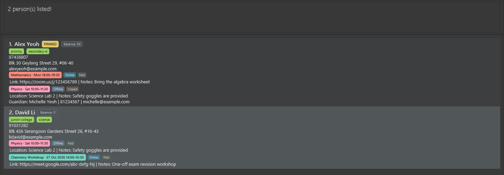

# TutEasy

## Private tutoring, organised

TutEasy brings your students, classes, lesson schedules, and payments together in one focused desktop app.
Its keyboard-first command interface keeps everyday updates fast, while the visual dashboard makes every student's
upcoming lessons and outstanding balance easy to review.

[**Download TutEasy**](https://github.com/AY2627S1-CS2103T-T12-2/tp/releases/latest) ·
[**Get started**](UserGuide.html#quick-start) ·
[**Explore every feature**](UserGuide.html#features)

## Everything a private tutor needs at a glance

* Keep student and guardian contact details in one place.
* Organise weekly and one-off classes with online or offline lesson details.
* Track individual payment status and outstanding balances.
* Review a full weekly timetable and move between weeks instantly.
* Find, pin, tag, and update students without leaving the keyboard.
* Mask sensitive details on screen with privacy mode.

## Built for a fast tutoring workflow

Type concise commands to add students, schedule classes, record payments, or search your records. TutEasy validates
each change, updates the dashboard immediately, and saves your data automatically, so you can spend less time on
administration and more time teaching.

TutEasy runs locally on your computer and requires Java 25 or later. Follow the
[Quick Start guide](UserGuide.html#quick-start) to be up and running in minutes.

---

Want to contribute? See the [Developer Guide](DeveloperGuide.html) and
[project repository](https://github.com/AY2627S1-CS2103T-T12-2/tp).

TutEasy is built with [JavaFX](https://openjfx.io/) and [Jackson](https://github.com/FasterXML/jackson).
